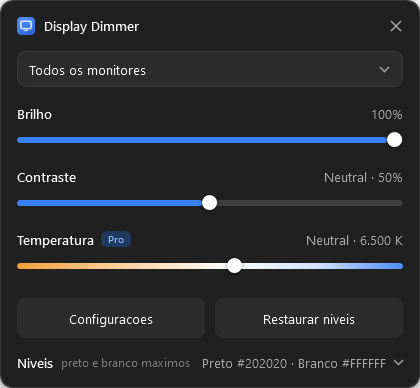
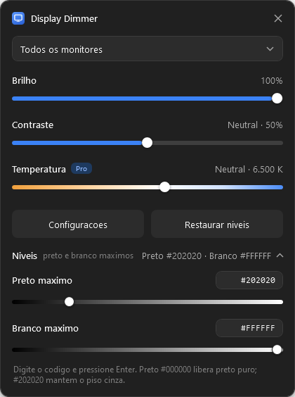
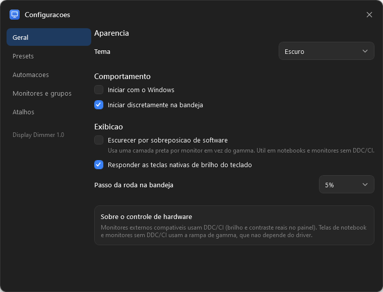

# Display Dimmer

Controle rápido e confiável de brilho, contraste e temperatura de cor para monitores externos e para a tela do notebook, com presets, agendamentos, regras por aplicativo, atalhos globais, bandeja do sistema e controle por linha de comando.







## Recursos

- **Brilho, contraste, temperatura e níveis** por monitor, por grupo ou em todos ao mesmo tempo.
- **DDC/CI (hardware)** em monitores externos compatíveis, com **escurecimento por software** (rampa de gamma) como alternativa para telas de notebook e monitores sem DDC/CI.
- **Preto e branco máximos ajustáveis**: escolha o preto mais escuro (de `#000000` a `#A0A0A0`, padrão `#202020`) e o branco mais claro, digitando o código da cor ou usando os sliders.
- **Redução de luz azul** de 1900 K a 10000 K, com 6500 K como neutro.
- **Presets** aplicáveis pela janela principal, bandeja, atalhos, agendamentos, regras por aplicativo e linha de comando.
- **Níveis relativos preservados**: ao ajustar "Todos os monitores", cada tela mantém a diferença em relação às demais.
- **Agendamentos** ao longo do dia (hora, preset e parâmetros afetados).
- **Regras por aplicativo** e por **tela cheia**, com restauração do estado anterior ao sair.
- **Cartões de automação** mostrando o que está ativo ou pausado.
- **Grupos de monitores** controlados em conjunto.
- **Bandeja do sistema**: roda do mouse ajusta em passos de 5% (configurável), clique abre a janela, menu com presets, automações e inicialização.
- **Atalhos globais** e suporte às **teclas nativas de brilho** do teclado quando o driver expõe HID Consumer.
- **Linha de comando** para PowerShell e scripts, inclusive com o aplicativo já aberto.
- **Temas** escuro, claro e do sistema.

## Requisitos

- Windows 10 ou 11 (x64).
- .NET 8 Desktop Runtime. Para compilar, .NET 8 SDK.

## Compilar

```powershell
dotnet build DisplayDimmer.sln -c Release
```

Gerar a pasta `dist` pronta para uso:

```powershell
dotnet publish src/DisplayDimmer/DisplayDimmer.csproj -c Release -r win-x64 --self-contained false -o dist
```

Ou use `build.cmd`, que executa exatamente esse comando.

Para uma versão sem dependência do runtime instalado, troque `--self-contained false` por `--self-contained true` e adicione `-p:PublishSingleFile=true`.

## Executar

```powershell
.\dist\DisplayDimmer.exe
```

Na primeira execução a janela principal aparece. Depois disso o aplicativo inicia discreto na bandeja, conforme a opção "Iniciar discretamente na bandeja".

Para abrir a janela a partir da bandeja: clique no ícone ou use `DisplayDimmer.exe --show`.

## Como usar

### Janela principal

- **Seletor**: "Todos os monitores", um grupo ou um monitor específico.
- **Brilho**: 0 a 100%. Em monitores com DDC/CI o ajuste é feito no próprio painel; nos demais, por software.
- **Contraste**: 0 a 100%, com 50% sendo neutro. Usa DDC/CI quando disponível e gamma quando não.
- **Temperatura**: 1900 K (quente) a 10000 K (frio), 6500 K neutro.
- **Configurações**: abre a janela de presets, automações, monitores e atalhos.
- **Restaurar níveis**: volta para 100% / 50% / 6500 K / `#202020` / `#FFFFFF` no alvo selecionado.
- **Níveis**: clique na linha para abrir os campos de **Preto máximo** e **Branco máximo**. Digite o código da cor (`#000000`, `#202020`, `#DCDCDC`…) e pressione Enter, ou arraste o slider.

### Bandeja do sistema

- Roda do mouse sobre o ícone: altera o brilho no passo configurado (padrão 5%).
- Clique: abre a janela principal.
- Clique direito: presets, automações, iniciar com o Windows, configurações e sair.

### Presets

Em **Configurações → Presets**, digite um nome e clique em "Salvar estado atual". O preset guarda brilho, contraste e temperatura de cada monitor. Depois é possível aplicá-lo pela lista, pela bandeja, por atalho, por agendamento, por regra ou pela linha de comando.

### Agendamentos

Em **Configurações → Automações**, informe nome, horário (`HH:mm`), preset e quais parâmetros serão alterados. Os agendamentos são reaplicados mesmo após suspensão, dentro de uma janela de 30 minutos.

### Regras por aplicativo

Na mesma aba, informe o nome do processo (por exemplo `chrome`) ou marque "Somente em tela cheia". Ao focar o aplicativo, o preset é aplicado; ao sair, o estado anterior é restaurado (opção "Restaurar ao sair").

### Grupos

Em **Configurações → Monitores e grupos**, marque os monitores e crie um grupo. O grupo aparece no seletor da janela principal e aceita presets e atalhos como qualquer outro alvo.

### Atalhos

Padrões: `Ctrl+Alt+Up` (aumentar), `Ctrl+Alt+Down` (diminuir), `Ctrl+Alt+D` (abrir janela), `Ctrl+Alt+A` (pausar/ativar automações). Cada preset pode ter o próprio atalho. Se uma combinação já estiver em uso por outro programa, a janela de configurações informa qual falhou.

### Teclas nativas de brilho

O aplicativo escuta os usos HID Consumer `0x006F` (aumentar) e `0x0070` (diminuir). Funciona quando o teclado/driver expõe essas teclas como HID; em alguns notebooks o driver trata a tecla internamente e ela não chega ao Windows. Nesse caso use os atalhos globais.

## Configuração

Arquivo: `%APPDATA%\DisplayDimmer\settings.json`

Guarda tema, preferências, presets, grupos, agendamentos, regras, atalhos e o último estado de cada monitor. Se o arquivo estiver corrompido, ele é renomeado para `settings.corrupted-AAAAMMDD-HHMMSS.json` e um novo é criado.

## Preto e branco máximos

Em **Níveis** (janela principal) ou `--set black=#202020 white=#FFFFFF`:

- **Preto máximo**: nenhum pixel da tela fica mais escuro que esse valor. Digite `#000000` para preto puro, `#202020` para o piso cinza (padrão) ou qualquer tom até `#A0A0A0`.
- **Branco máximo**: nenhum pixel fica mais claro que esse valor. Baixar o branco reduz o ofuscamento em ambientes escuros sem escurecer o preto, útil para telas muito claras à noite.

O campo aceita `#RRGGBB`, `#RGB` ou o nível em hexadecimal (`20` = 32). Como os níveis são tons de cinza, cores com canais diferentes usam a média dos três. Pressione **Enter** para aplicar; **Esc** desfaz o que foi digitado.

Os dois valores são salvos por monitor e entram nos presets. A rampa resultante é `saída = preto + (branco - preto) × curva`.

## DDC/CI, software e o seletor de controle

Cada monitor tem um modo em **Configurações → Monitores e grupos**:

| Modo | Comportamento |
|---|---|
| Automático | Usa DDC/CI quando ele realmente funciona; cai para software quando não |
| DDC/CI (hardware) | Força o controle no painel do monitor |
| Software (gamma) | Força a rampa de gamma, mesmo em monitores com DDC/CI |

No modo automático o aplicativo **confirma cada escrita**: depois de enviar o brilho por DDC/CI ele lê o valor de volta. Se o monitor aceitar o comando e não mudar (ou devolver um handle inválido, como acontece com alguns drivers), ele passa a usar gamma automaticamente e mostra "sem DDC/CI" na lista de monitores. É isso que garante que o slider de brilho sempre tenha efeito na tela.

## Solução de problemas

| Sintoma | Causa provável | O que fazer |
|---|---|---|
| Monitor externo não muda de brilho | DDC/CI desligado no OSD do monitor, driver sem suporte ou driver que aceita o comando sem aplicar | Ative DDC/CI no menu do monitor; em Configurações → Monitores, escolha **Software (gamma)**. O `--debug` mostra se a última aplicação foi por DDC/CI ou gamma |
| Brilho volta ao normal ao abrir um jogo | O jogo redefine o modo de vídeo e o Windows reinicia a rampa de gamma | O aplicativo reaplica os valores ao detectar mudança de tela (verificação a cada 8 s) |
| Teclas de brilho do notebook não funcionam | Driver trata a tecla sem expor HID | Use os atalhos globais |
| Escurecimento por sobreposição cobre a própria janela | A camada preta fica acima de todas as janelas | Desligue a sobreposição e use gamma, ou feche a janela durante o ajuste |
| Atalho não funciona | Combinação já registrada por outro programa | Veja a mensagem em Configurações → Atalhos |

Diagnóstico:

```powershell
.\DisplayDimmer.exe --debug          # monitores, DDC/CI, ultima aplicacao e rampa de gamma atual
.\DisplayDimmer.exe --ddc            # testa leitura e escrita DDC/CI sem alterar o brilho
$env:DISPLAYDIMMER_LOG=1             # grava log em %TEMP%\displaydimmer-ipc.log
```

## Estrutura do projeto

```
src/DisplayDimmer/
  Interop/    P/Invoke (DDC/CI, gamma, monitores, bandeja, hooks)
  Models/     Configuração e estado persistido
  Services/   Controlador de exibição, automações, bandeja, IPC, temas
  ViewModels/ Estado das janelas
  Views/      Janela principal e configurações
  Themes/     Temas escuro e claro + estilos
  Cli/        Linha de comando
tickets/      Tickets do processo de desenvolvimento
docs/         Documentação
```

Detalhes técnicos em [arquitetura.md](arquitetura.md) e referência de comandos em [cli.md](cli.md).
